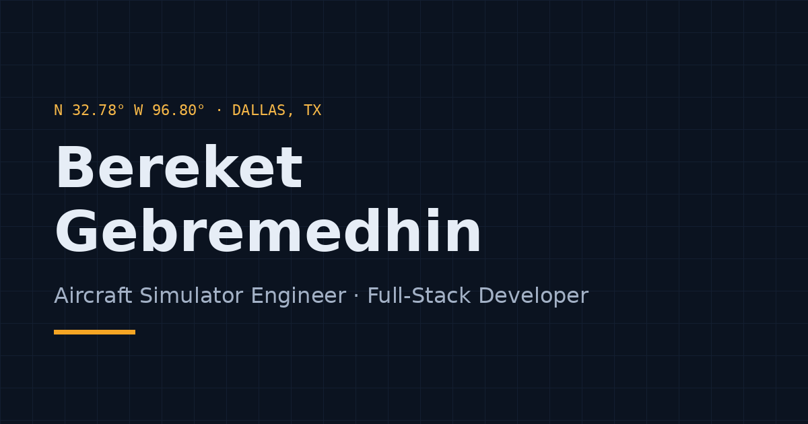

# Bereket Gebremedhin — Personal Portfolio

A fast, accessible, single-page portfolio for an **Aircraft Simulator Engineer & Full-Stack Developer**.
Built with plain HTML5, CSS3, Bootstrap 5 and a small amount of vanilla JavaScript. No build tools, no frameworks.


<!-- [REPLACE] Take a real screenshot (1200x630) and save it as assets/images/screenshot.png, then update the path above. -->

**Live site:** https://[REPLACE-username].github.io/portfolio/

---

## Design

"Night Cockpit": a dark instrument-panel palette with amber annunciator accents, Space Grotesk + Inter + JetBrains Mono, and aviation motifs that carry real information (waypoint section labels, hero readouts, a flight-path timeline, a credentials checklist). Every color pair is verified for WCAG AA in both themes. Full reference: **[docs/DESIGN-SYSTEM.md](docs/DESIGN-SYSTEM.md)**.

## Features

- Sticky navbar with ScrollSpy, an "Available" status chip, shrink-on-scroll and an amber scroll-progress line
- Hero with location, value statement, "View projects" and "Download resume" buttons, portrait in a display bezel and three readouts
- About ("flight log" facts), Skills (grouped as SYS 01–04, with usage meters), filterable Projects with a full-width featured card, a 2 × 2 grid and STACK / ROLE / RESULT specs, Experience as a flight-path timeline, Credentials checklist, Contact with copy-email button
- Light / dark mode toggle that remembers your choice (`localStorage`)
- Contact form via Formspree with client-side validation, success/error messages, honeypot spam trap, and a `mailto:` fallback
- Fade-in on scroll that turns itself off for users with `prefers-reduced-motion`
- Accessibility: semantic landmarks, skip link, ARIA labels, visible focus, WCAG AA colors
- SEO: meta description, Open Graph / Twitter cards, canonical URL, favicon, `sitemap.xml`, `robots.txt`
- Lazy-loaded images with fixed dimensions (no layout shift)

## Tech stack

| Layer | Tool |
|---|---|
| Markup | HTML5 |
| Styling | CSS3 custom properties (design tokens) + Bootstrap 5.3 (CDN) |
| Icons | Bootstrap Icons 1.11 (CDN) |
| Fonts | Google Fonts: Space Grotesk (headings), Inter (body), JetBrains Mono (labels) |
| Scripts | Vanilla JavaScript (one file, ~230 lines) |
| Forms | Formspree |
| Hosting | GitHub Pages (or Netlify) |

## Folder structure

```
portfolio/
├── index.html              # The whole page
├── css/tokens.css          # Design tokens: colors, fonts, sizes, spacing (both themes) + Bootstrap overrides
├── css/style.css           # Components, built only from tokens
├── js/main.js              # Theme toggle, navbar scroll, filter, fade-ins, copy email, form
├── assets/
│   ├── images/             # Profile photo, project images, favicon.svg, og-image.png
│   └── resume/Bereket-Gebremedhin-Resume.pdf   # Placeholder — replace with your resume
├── favicon.ico
├── sitemap.xml
├── robots.txt
├── .nojekyll               # Tells GitHub Pages to serve files as-is
├── README.md
├── LICENSE
└── docs/                   # Deployment, customization, resume, cover letter, etc.
```

## Run locally

**Option 1 — just open it.** Double-click `index.html`. Everything works except the Formspree submission (browsers block it from `file://`; the mailto fallback still works).

**Option 2 — tiny local server (recommended).**

```bash
cd portfolio
python3 -m http.server 8000
# then open http://localhost:8000
```

Or in VS Code, install the **Live Server** extension and click "Go Live".

## Customize

Search the project for `[REPLACE]` — every placeholder is marked. See **[docs/CUSTOMIZATION-GUIDE.md](docs/CUSTOMIZATION-GUIDE.md)** for a step-by-step walkthrough (text, colors, fonts, projects, images).

## Deploy

See **[docs/DEPLOYMENT.md](docs/DEPLOYMENT.md)** for GitHub Pages, Netlify, and custom domains.

## Other documents in `/docs`

| File | Purpose |
|---|---|
| `DESIGN-SYSTEM.md` | Design direction (Concept A chosen), color/type/spacing tokens with contrast ratios, wireframes, component specs, review checklist |
| `mockups/concept-a.html` | The approved visual mockup (open in a browser) |
| `DEPLOYMENT.md` | Publish to GitHub Pages or Netlify, add a custom domain |
| `CUSTOMIZATION-GUIDE.md` | Exactly where to edit everything |
| `RESUME.md` | One-page ATS-friendly resume to export to PDF |
| `COVER-LETTER-TEMPLATE.md` | Reusable cover letter |
| `PROJECT-CASE-STUDIES.md` | Problem → Approach → Tech → Challenges → Result for each project |
| `LINKEDIN-PROFILE.md` | Headline, About, and Featured text that match the site |
| `TESTING-CHECKLIST.md` | What to check before (and after) you go live |

## Credits

- [Bootstrap](https://getbootstrap.com/) and [Bootstrap Icons](https://icons.getbootstrap.com/) — MIT
- [Google Fonts](https://fonts.google.com/): Space Grotesk, Inter, JetBrains Mono — SIL Open Font License
- [Formspree](https://formspree.io/) for form handling

## License

MIT — see [LICENSE](LICENSE). You may reuse the code; please replace the personal content with your own.
